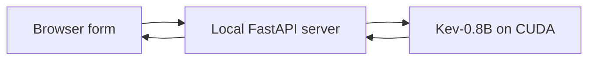

# Kev Local Lab

A local browser playground for experimenting with [Kev](https://github.com/jaredpalmer/kev),
a small decision model. Enter evidence, build typed questions, and inspect the
answers and probability distributions without writing JSON or calling an API manually.

**Status:** Experimental; verified on Windows with an NVIDIA GPU.

**Next action:** Evaluate new examples and inspect model failures.

**Last reviewed:** 2026-10-11.

## Requirements

- Windows x64 and PowerShell.
- An NVIDIA GPU with BF16 support and a driver compatible with CUDA 12.8.
  The tested configuration has 6 GB VRAM and 24 GB system RAM.
- Internet access for installation and the first model download, plus several
  GB of free disk space for Python, CUDA packages, caches, and weights.

The provided scripts target Windows/CUDA. CPU, macOS, and Linux setups are not
covered. No paid account or inference API key is required.

## Install and run

From the repository folder in PowerShell:

```powershell
./setup.ps1
./start.ps1
```

Open **http://127.0.0.1:8018** after the server reports that startup is complete.
The first start downloads the model. Later starts reuse its local cache;
Hugging Face metadata checks may still use the network.

After a successful first start, cached weights can be used without metadata
lookups by setting `$env:HF_HUB_OFFLINE = '1'` in the starting console.
Set `$env:HF_HUB_OFFLINE = $null` to allow model downloads again.

Keep the console open. Ctrl+C stops the server. To stop this checkout's running
lab from another console, use `./stop.ps1`. Closing the browser does not stop it.
After installation, `run.cmd` also starts the lab. To use another port:

```powershell
./start.ps1 -Port 8020
```

If PowerShell blocks local scripts, run each script with
`powershell.exe -NoProfile -ExecutionPolicy Bypass -File .\setup.ps1` or
`powershell.exe -NoProfile -ExecutionPolicy Bypass -File .\start.ps1`.
This applies to that process; it does not change the system execution policy.

## Use the form

The page starts with a blank **State** and no questions. Add a question, give it
a unique name and instructions, then choose a type:

| Type | Input | Result |
| --- | --- | --- |
| Choice | 2–255 named options; optional descriptions | Winning option and distribution |
| Yes / No | Optional descriptions of each meaning | P(yes), without a decision threshold |
| Score | 2–255 distinct descriptions ordered low to high | Expected level index, starting at 0 |

**Run decision** shows results beneath each question. Required fields and
duplicate names are checked before submission. Editing inputs marks old results
as stale. Switching type retains its draft fields. **Advanced / JSON preview**
shows the generated request.

**Load example** replaces the current draft with one of eight guided cases.
Expected labels are teaching aids and are never sent to the model.
**Clear form** resets the draft while preserving the tab's session history.
**Export session JSON** downloads the requests and responses; exports are limited
to 16 MiB of encoded form data. Reloading or closing the tab loses its history.

## Experiment and verify

1. Predict an answer before running a clear billing or shipping example.
2. Change one fact or reword the same evidence, then compare probabilities.
3. Try missing evidence, ambiguity, negation, and ordered score levels.
4. Select a Choice question and run **Test option order × 6**. Duplicate orders
   can occur; inspect whether the winning option changes.

Probabilities are estimates, not guarantees. The supplied examples are a small
authored set, not an accuracy benchmark. In particular, changing the refund case
from unopened to opened has produced an incorrect approval despite its explicit
rejection rule. English is the documented language; evaluate other languages separately.

With the server running, execute the API integration checks:

```powershell
.\.venv\Scripts\python.exe .\verify.py
# For a different port:
.\.venv\Scripts\python.exe .\verify.py --port 8020
```

The checks exercise real GPU inference, probability contracts, repeated requests,
permutations, malformed requests, browser-origin restrictions, and downloads.
Model accuracy observations are recorded separately from application assertions
in the ignored `results/verification.json`.
Use the [manual checklist](manual-test-checklist.md) to review form behavior.

## Components and reproducibility



This repository implements the form, guided cases, download endpoint, installation
scripts, and verification workflow. Inference and the decision API come from the
unmodified upstream Kev package. It does not train or fine-tune a model.

- Kev source: `2ecafc49fe1e8945cd600443e6c04c1cf0b3a78f`, downloaded during setup.
  Upstream code is licensed under Apache-2.0.
- Model: [jaredpalmer/kev-0.8b](https://huggingface.co/jaredpalmer/kev-0.8b),
  v1.0 weights pinned to revision `bf75a6a8848ea6960ff2ed108d9ed44c2941174f`.
  Its backbone is `Qwen/Qwen3.5-0.8B-Base`; upstream controls backbone resolution.
- uv 0.12.10 and Python 3.13.15; PyTorch 2.8.0+cu128 and Transformers 5.19.0.
  [requirements.txt](requirements.txt) pins the package versions.
- Fused kernels and CUDA graphs are disabled; serving uses the PyTorch BF16 path.

`.tools/`, `.runtime/`, and `.venv/` contain downloaded tools, source, caches,
weights, and packages. They are ignored by Git, along with local reports and
session exports. Setup does not install a global Python.

The server binds to loopback. Host and browser-origin checks block access through
unrelated hostnames and websites. It has no user accounts and is intended for
local experimentation. Do not expose it as a hosted service.

Drafts and history live in browser memory. Export returns an attachment without
storing it on the server. Kev also keeps an in-memory prefix cache during serving.
Exported sessions contain the original inputs: inspect them before sharing.
